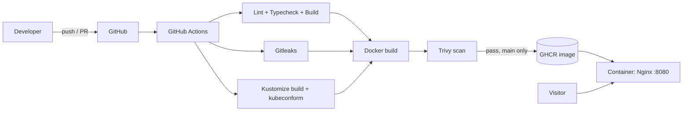

# 🚀 Ricky Rohaendi — Portfolio Website


Welcome to my personal portfolio website! This project showcases my journey as a developer & designer through modern web experiences, UI/UX exploration, and real-world projects.

🌐 **Live Website:** [ricky-rohaendi-portfolio.vercel.app](https://ricky-rohaendi-portfolio.vercel.app)

> This repository is also my **DevOps playground**: the site is containerized, built and scanned by a CI/CD pipeline, published as a public image, and described with Kubernetes manifests that are validated on every PR. Infrastructure as Code is next on the roadmap (see below).

## ✨ About

This portfolio was built to represent who I am, what I create, and how I solve problems through technology and design. Inside this website, you'll find:

- Personal introduction
- Selected projects & case studies
- UI/UX design explorations
- Skills & technologies
- Contact information

## 🛠️ Tech Stack

| Layer         | Technology                                             |
| ------------- | ------------------------------------------------------ |
| Frontend      | React, TypeScript, Vite, Tailwind CSS, Framer Motion   |
| Hosting       | Vercel (live site)                                     |
| Container     | Docker (multi-stage), Nginx unprivileged               |
| Orchestration | Kubernetes manifests with Kustomize (dev and prod)     |
| CI/CD         | GitHub Actions                                         |
| Security      | Trivy (image scan), Gitleaks (secret scan), Dependabot |
| Validation    | kubeconform (Kubernetes manifest schema check)         |
| Registry      | GitHub Container Registry (GHCR)                       |

## 🎨 Features

- Responsive modern UI
- Smooth animations & transitions
- Clean and minimal design
- Optimized performance
- Mobile-friendly experience

## 📂 Projects Highlight

- E-Commerce Design
- Tour & Travel Project
- UI/UX Exploration
- Web Development Projects
- Creative Landing Pages

## ⚙️ DevOps

### Architecture



### CI/CD pipeline

1. **test**: `npm ci`, lint, `tsc --noEmit`, tests, build.
2. **secret-scan**: Gitleaks scans the full commit history.
3. **k8s-validate**: renders every Kustomize overlay with `kubectl kustomize` and validates the output against Kubernetes schemas with `kubeconform`.
4. **docker**: runs only after the three jobs above pass. It builds the image, scans it with Trivy (fails on fixable HIGH/CRITICAL findings), and pushes to GHCR only on `main`.
5. **Dependabot** opens weekly PRs for npm, Docker, and GitHub Actions dependencies.

### Run with Docker

```bash
docker compose up --build
# open http://localhost:8080
```

Health check:

```bash
curl http://localhost:8080/health
```

### Run without Docker

```bash
npm ci
npm run dev
```

### Kubernetes

Manifests live in `k8s/` and are managed with Kustomize, with separate `dev` and `prod` overlays.

Render an overlay locally:

```bash
kubectl kustomize k8s/overlays/dev
kubectl kustomize k8s/overlays/prod
```

CI renders both overlays and validates them with kubeconform on every PR, so a broken manifest blocks the image push.

### Technical decisions

- **Multi-stage build:** the final image contains only Nginx and the static build output, with no Node.js and no source code, keeping it small and reducing the attack surface.
- **Non-root, locked-down runtime:** the container runs as a non-root user with a read-only filesystem, all Linux capabilities dropped, and `no-new-privileges` enabled.
- **Layer caching:** dependencies are installed in a separate stage so rebuilds stay fast.
- **Health endpoint:** `/health` is used by the Docker `HEALTHCHECK` and is ready for orchestrator probes.
- **No secrets in the image:** this site needs no API keys at build or run time.
- **Manifests are validated before shipping:** the image is only built and pushed after the Kubernetes overlays render and pass schema validation.

### Roadmap

- [x] Dockerfile, Nginx config, and docker-compose
- [x] CI pipeline with Gitleaks and Trivy
- [x] Dependabot
- [x] Kubernetes manifests with Kustomize (dev and prod overlays)
- [x] Manifest validation in CI (kubectl kustomize + kubeconform)
- [x] Terraform: local kind cluster + Traefik ingress
- [x] Terraform: Argo CD installation
- [x] GitOps: Argo CD Application for the dev overlay
- [ ] Observability with Prometheus and Grafana
- [ ] GitOps deployment with ArgoCD
- [ ] Observability with Prometheus and Grafana
- [x] IaC validation in CI (terraform fmt/validate + Trivy config)

## 📬 Contact

Feel free to connect or collaborate with me:

- Email: rickyrohaendi1@gmail.com
- LinkedIn: [linkedin.com/in/ricky-rohaendi](https://www.linkedin.com/in/ricky-rohaendi/)
- GitHub: [github.com/rickyrohaendi12](https://github.com/rickyrohaendi12)

## 📌 Note

This portfolio will continue to evolve as I learn, build, and explore new technologies.

---

⭐ If you like this project, feel free to give it a star and support my journey!
