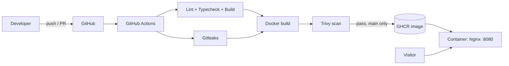

# 🚀 Ricky Rohaendi — Portfolio Website


Welcome to my personal portfolio website! This project showcases my journey as a developer & designer through modern web experiences, UI/UX exploration, and real-world projects.

🌐 **Live Website:** [ricky-rohaendi-portfolio.vercel.app](https://ricky-rohaendi-portfolio.vercel.app)

> This repository is also my **DevOps playground**: the site is containerized, built and scanned by a CI/CD pipeline, and published as a public image. Kubernetes and Infrastructure as Code are next on the roadmap (see below).

## ✨ About

This portfolio was built to represent who I am, what I create, and how I solve problems through technology and design. Inside this website, you'll find:

- Personal introduction
- Selected projects & case studies
- UI/UX design explorations
- Skills & technologies
- Contact information

## 🛠️ Tech Stack

| Layer     | Technology                                             |
| --------- | ------------------------------------------------------ |
| Frontend  | React, TypeScript, Vite, Tailwind CSS, Framer Motion   |
| Hosting   | Vercel (live site)                                     |
| Container | Docker (multi-stage), Nginx unprivileged               |
| CI/CD     | GitHub Actions                                         |
| Security  | Trivy (image scan), Gitleaks (secret scan), Dependabot |
| Registry  | GitHub Container Registry (GHCR)                       |

## 🎨 Features

- Responsive modern UI
- Smooth animations & transitions
- Clean and minimal design
- Optimized performance
- Mobile-friendly experience

## 📂 Projects Highlight

- E-Commerce Design
- Tour & Travel Project
- UI/UX Exploration
- Web Development Projects
- Creative Landing Pages

## ⚙️ DevOps

### Architecture



### CI/CD pipeline

1. **test**: `npm ci`, lint, `tsc --noEmit`, tests, build.
2. **secret-scan**: Gitleaks scans the full commit history.
3. **docker**: builds the image, scans it with Trivy (fails on fixable HIGH/CRITICAL findings), and pushes to GHCR only on `main`.
4. **Dependabot** opens weekly PRs for npm, Docker, and GitHub Actions dependencies.

### Run with Docker

```bash
docker compose up --build
# open http://localhost:8080
```

Health check:

```bash
curl http://localhost:8080/health
```

### Run without Docker

```bash
npm ci
npm run dev
```

### Technical decisions

- **Multi-stage build:** the final image contains only Nginx and the static build output, with no Node.js and no source code, keeping it small and reducing the attack surface.
- **Non-root, locked-down runtime:** the container runs as a non-root user with a read-only filesystem, all Linux capabilities dropped, and `no-new-privileges` enabled.
- **Layer caching:** dependencies are installed in a separate stage so rebuilds stay fast.
- **Health endpoint:** `/health` is used by the Docker `HEALTHCHECK` and is ready for orchestrator probes.
- **No secrets in the image:** this site needs no API keys at build or run time.

### Roadmap

- [x] Dockerfile, Nginx config, and docker-compose
- [x] CI pipeline with Gitleaks and Trivy
- [x] Dependabot
- [ ] Kubernetes manifests with Kustomize (Deployment, Service, Ingress, HPA, PDB)
- [ ] Terraform: local cluster (kind) + metrics-server + Gateway API controller + ArgoCD + monitoring
- [ ] GitOps deployment with ArgoCD
- [ ] Observability with Prometheus and Grafana
- [ ] IaC and manifest validation in CI (terraform validate, kubeconform, tfsec)

## 📬 Contact

Feel free to connect or collaborate with me:

- Email: rickyrohaendi1@gmail.com
- LinkedIn: [linkedin.com/in/ricky-rohaendi](https://www.linkedin.com/in/ricky-rohaendi/)
- GitHub: [github.com/rickyrohaendi12](https://github.com/rickyrohaendi12)

## 📌 Note

This portfolio will continue to evolve as I learn, build, and explore new technologies.

---

⭐ If you like this project, feel free to give it a star and support my journey!
